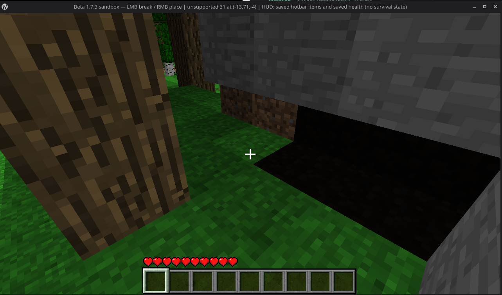

# BLOCK-PLACEMENT-002 — native placement faces and lighting refresh

## User report

On 2026-11-09 the viewer title reported `unsupported 31 at (-13,71,-4)` while
aiming at a block face. The user reports that some block sides reject placement
even when another side of the same block can be used. The same screenshot shows
a near-black region under a stone block; the user reports that placing a block
above can sometimes break the lighting. This is a report, not yet a controlled
reproduction or proof that both symptoms share one cause.

Screenshot SHA-256:
`ec49f04966f318ac28ea4129278a8cf145c7b2b5c1cb82560cb607d7a0ef37c6`.

## C01 — establish native placement contract (Codex)

- Pin the Rust build, world/scene inputs, target coordinates, hit face, selected
  item, camera, and edit sequence for each reproduction.
- In disposable original Beta 1.7.3 worlds, capture placement attempts against
  each relevant side and record accepted/rejected result, resulting block ID and
  metadata, inventory delta, neighbor state, and native light/height-map deltas.
- Include repeat placement, placement above/below, and chunk-edge cases. Keep
  unsupported block shapes separate from ordinary cube faces.
- Determine whether the reported `unsupported 31` is a ray-hit classification,
  a placement rule, or an unsupported target shape. Do not infer native rules
  from the viewer counter alone.

## A01 — implement only verified behavior (agy)

After C01, support the verified placement faces/blocks and reject only cases the
native contract rejects or that remain explicitly out of scope. Make edit,
light/height-map state, dirty chunks, and rebuilt meshes update consistently and
atomically. Add fixture-driven tests for every captured accept/reject and light
delta. Do not hide the issue by globally brightening the scene or swallowing
`unsupported` results.

## C02 — acceptance (Codex)

Compare Rust with the pinned native action and state corpus, exercise repeated
edits and chunk edges, and confirm visual refresh. Keep placement compatibility
claims limited to captured cases; the separate general shadow issue remains
tracked in [LIGHT-UPDATE-002](LIGHT-UPDATE-002.md).

### C01 evidence boundary (2026-11-10)

The controlled native corpus now covers 16 cases in fresh byte-array chunks.
It confirms a native ray hit on ID 31 metadata 0 for each of six center-axis
sample rays and records the result of the original placement action, stack
delta, neighborhood, and height/light samples. It also covers six ordinary
stone faces, repeat placement, an occupied destination, the east chunk edge,
and the y=127 build limit. This is enough to start the bounded Rust follow-up;
it does not establish arbitrary ID 31 ray geometry, all item orientations,
inventory/UI integration, or general lighting behavior. Light values in these
minimal worlds are zero, so the reported shadow/lighting refresh remains an
independent unresolved issue under LIGHT-UPDATE-002.
