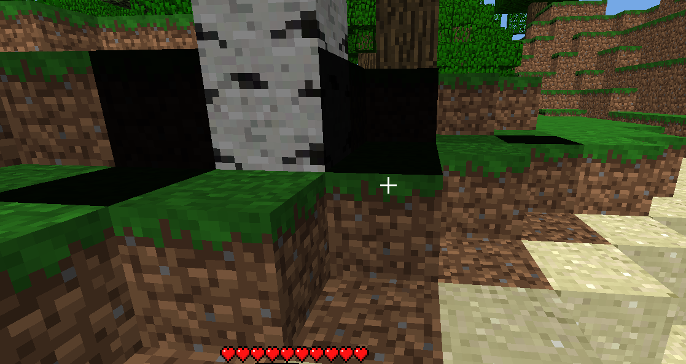

# LIGHT-UPDATE-002 — посторонняя тень после разрушения блока

Статус: C01 открыт в queue.json, причина пользовательского кадра не установлена.
Приоритет: высокий. Реализация A01 зависит от проверенного C01; конкретный
материальный/relight API фиксируется по результатам воспроизведения.

## Наблюдение пользователя

2026-11-09 пользователь сообщил: после разрушения блока **иногда** рядом
появляется странная тень. На кадре видны почти чёрные поверхности у земли и
стволов, в том числе рядом с берёзой. Это пользовательский кадр Rust-viewer,
а не эталон оригинала. Исходная последовательность edits, координаты, камера,
настройки и точный build SHA пока не записаны; детерминированный repro ещё нужен.

2026-11-11 пользователь повторил дефект в активной Wayland-сессии: после
установки ряда каменных блоков видна чёрная горизонтальная область под ним.
Захват `light-update-002-wayland-repro.png` (867×336, SHA-256
`7e9766500003c6d163b08e2ae9ba3738539dce4be811e3020ab24f8d086cafb8`) теперь
подтверждает Rust-side repro для установки блоков. Точные координаты/порядок,
значения света/height-map и парный кадр оригинала ещё не сняты; исходный мир
не изменялся. Сессия приложения закончилась до сохранения диагностического лога.

Повтор 2026-11-11 подтвердил пользователя словами: тёмная область возникла
именно **после постановки камня**, дефект не исправился. Второй кадр
`light-update-002-wayland-repro-2.png` (1278×719, SHA-256
`10662d68c6146af0faf6fef0b7d703676a976e492b0921b39ee81145979250cb`)
показывает чёрную область под поставленным каменным блоком среди травяных
блоков. Координаты не фиксировались, причина пока не установлена.

2026-11-13 исправлена отдельная ошибка на границе чанков: mesh соседнего
загруженного чанка зависит от освещённости прилегающей клетки и теперь
перестраивается, когда эта освещённость изменилась. Регрессии проверяют чтение
света на шве и dirty-набор для отрицательных координат. Не подтверждено, что
именно эта ошибка вызывает пользовательский кадр вне границ чанков.
Диагностический `BETA_TRACE_LIGHT_EDITS=1` дополнительно записывает свет в
соседних клетках после редактирования. Независимый synthetic grass corpus из
`python3 tools/oracle/light_grass_check.py` сравнивает установку/удаление камня
с оригиналом по всем 294912 клеткам; он не проверяет GPU или последовательность
правок и не закрывает пользовательский дефект.

SHA-256 исходного PNG:
`64fff96adb875c64df1198c94b8fe541b9da6084ed4129d93ff6661e183ceaa9`.

Дополнительное наблюдение пользователя от 2026-11-09: после установки блока
сверху освещение иногда нарушается; приложенный кадр показывает почти чёрную
область под каменным блоком. Это не подтверждает, что причина совпадает с
первоначальной тенью после разрушения. Общая фиксация кадра и координат — в
[BLOCK-PLACEMENT-002](BLOCK-PLACEMENT-002.md); SHA-256 изображения
`block-placement-unsupported-31.png`:
`ec49f04966f318ac28ea4129278a8cf145c7b2b5c1cb82560cb607d7a0ef37c6`.

Промежуточный результат: native registry из 256 записей и три synthetic edit
captures с полным pre-edit состоянием закреплены в `tests/fixtures/light_material/`.
В `1c83d2c` исправлены opacity callback (листва=1, вода=3 вместо255) и direct-sky
attenuation (water-place даёт12 вместо15). Rust совпадает по 19 sampled light
states; прежние LIGHT-UPDATE-001 tests проходят. Это отдельные подтверждённые
ошибки, не полная приёмка пользовательского кадра. Native log removal также
ставит соседней листве metadata bit8; эта lifecycle-логика здесь не реализована.

Дополнительный V2 corpus (`native_edits_v2.tsv`, SHA-256
`d12c5ba682813944647dbe3ac74e7d61235684d122cf40e8d9bc5440b78d8222`)
содержит полные native snapshots до/после восьми edits, включая высоты и дельты.
`light_snapshot_probe` сравнил все 294912 клеток каждого результата. Свет кроны
при установке/удалении ствола и воды в обе стороны совпал полностью; при удалении
ствола осталось 12 metadata-расхождений листвы. Выявлены отдельные расхождения
света при установке листвы (2107 клеток), установке glowstone на шве чанков
(6195) и его удалении (3852). Это диагностический **FAIL**, не новый pass;
прежняя выборочная приёмка не обобщается на эту область.

Новый synthetic `opaque-overhead-place-remove` добавлен в V2 corpus 2026-11-10.
Он проверяет установку/удаление каменного блока над освещённой клеткой: native
sky-light меняется 15→14→15, а целевая колонка height-map 64→66→64. Rust совпал
с native по всем 294912 клеткам каждой фазы (свет, ID, metadata — 0 различий).
Этот случай не воспроизводит чёрную область пользовательского кадра; сравнение
height-map, mesh/GPU vertex lighting и cumulative engine-state всё ещё отсутствует.

Предыдущий [LIGHT-UPDATE-001](LIGHT-UPDATE-001.md) принят только для пяти
synthetic native-сцен. Эти результаты сохраняются, но не закрывают новый дефект
и не подтверждают правильность освещения произвольного пользовательского мира.

## C01 — воспроизведение и оригинальный эталон (Codex)

- Подготовить отдельные копии одного закреплённого мира для оригинальной
  Beta 1.7.3 и Rust. Исходные сохранения пользователя использовать read-only.
- Зафиксировать build/JAR SHA, входные хеши, координаты и порядок удалений,
  положение и направление камеры, время, измерение и настройки графики.
  Снять одинаковый ракурс до edit и после завершения очереди обновлений.
- Начать с удаления блока у травы/ствола под листвой; проверить одно удаление,
  несколько последовательных удалений, обратную установку, внутреннюю область
  и шов чанков. Не выдавать этот набор за точный repro пользовательского кадра.
- Снять native block/sky-light, height-map и используемый при рисовании свет
  затронутых клеток; закрепить входы и два повторяемых native capture.
- Разделить проверяемые гипотезы: распространение и height-map/очередь,
  opacity листвы и стволов, границы загруженной сцены, согласованность двух
  хранилищ блоков/света, dirty chunks, свет вершин и публикация GPU-буферов.
  Ни одна из них пока не считается установленной причиной.

## A01 — исправление по подтверждённому repro (исполнитель Rust)

Исправить первый установленный источник расхождения по C01. Согласовать конечные
значения света, данные чанков, dirty-набор, меши и отображаемый кадр после edit.
Сохранить атомарность при ошибке и явную обработку незагруженных соседей.
Добавить регрессию на воспроизведённый случай и последовательные break/place.

Не устранять симптом общим увеличением яркости, принудительным sky-light=15,
отключением затемнения или обнулением света всей сцены. Реальные тени оригинала
должны сохраняться. Оптимизация не должна возвращать заметную задержку edits;
полный rebuild допустим как диагностическое сравнение, но не как заявленное
исправление производительности.

## C02 — приёмка (Codex)

- Rust совпадает с native по закреплённым block/sky-light и sampled brightness;
  прежние LIGHT-001/LIGHT-UPDATE-001 fixtures продолжают проходить.
- Парные кадры оригинала и Rust при одинаковых условиях подтверждают
  исчезновение лишней тени и сохранение настоящего затемнения. Политику
  pixel-сравнения и допустимые GPU-различия определить до оценки результата.
- Повторные edits, границы чанков и материал листвы проверены; состояние обоих
  хранилищ, dirty-набор и отображение согласованы. Ошибка обновления атомарна.
- Полный workspace check проходит, исходные миры сохраняют хеши.
  Отсутствие GUI/capture фиксируется как незавершённая визуальная приёмка.
